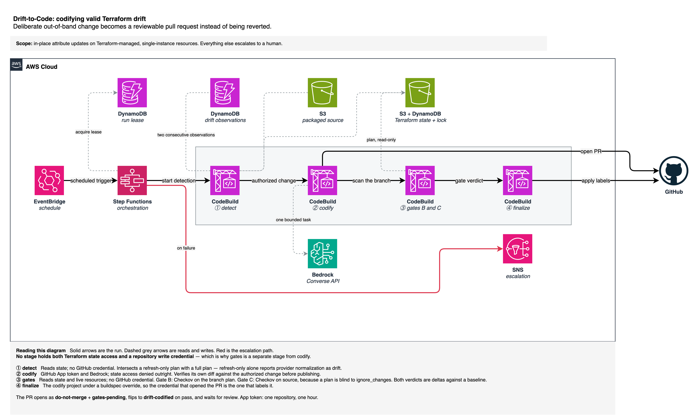

# Drift-to-code reconciliation — reference implementation

Detects valid Terraform drift and codifies it back into source as a reviewable pull
request.

The scope is deliberately narrow: **in-place `["update"]` drift on single-instance,
state-managed, operator-owned attributes**. Everything else — `for_each` per-instance
drift, delete/recreate, shared `tfvars` values, controller-owned attributes,
unmanaged resources — is detected and escalated to a human, never auto-codified.

Everything the model is not allowed to decide is decided before it runs. `drift-authorize`
emits a **work order** — one resource, and for each authorized attribute exactly one file,
one line, the identifier expected on that line, and the value observed in the cloud.
`drift-verify` then reads the model's diff and refuses anything the work order did not name.
That is what lets the model be treated as untrusted rather than merely constrained: a prompt
injection that changed its behaviour still has to produce a diff that passes the verifier.

## Architecture



Four CodeBuild stages sequenced by Step Functions, serialized per workspace by a DynamoDB
lease. The property the diagram is drawn to make checkable: **no stage holds both Terraform
state access and a repository write credential.** `docs/pipeline.png` is rendered from
`docs/pipeline.drawio` — edit the drawio, then re-export, or the two drift apart.

| Stage | Reads state | Writes to GitHub |
|---|---|---|
| ① detect | yes | no |
| ② codify | denied outright | yes |
| ③ gates | yes | no |
| ④ finalize | denied outright | yes |

Gates is a separate stage from codify for that reason. A branch plan needs state, so merging
the two would produce one credential that reads every resource you manage and writes to your
repository.

```
src/driftcode/    the payload: detection, scope guard, tracing, signing, verify, write path
terraform/        the launcher: provisions the pipeline and packages src/ as its source
tests/            offline tests; no AWS calls
docs/             the diagram, design notes, and development guide
```

`docs/design.md` explains why the implementation is shaped the way it is — two plans instead
of one, the policy-scan projection, the two-observation debounce, and why the edit site is not
the resource block. Read it before changing any of them.
`docs/development.md` covers the module-by-module layout, running each stage by hand, and the
test fixtures.

## Prerequisites

- Terraform >= 1.5 and an AWS account with permission to create IAM roles, CodeBuild
  projects, a Step Functions state machine, DynamoDB tables, S3 buckets and Secrets Manager
  secrets
- Python 3.9+ (the build environment uses 3.12)
- A **target** Terraform workspace to watch, using an **S3 backend with locking enabled**.
  Locking is a hard requirement, not a preference: detection runs
  `terraform plan -refresh-only` with locking so it reads a consistent snapshot and fails
  loudly if another operation holds the lock. Local state has no lock to acquire.
- A read-only credential for cloning the target repository, and — for the write path — a
  GitHub App installed on that repository with `contents: write` and `pull_requests: write`.
  Both go in Secrets Manager; see `terraform/variables.tf`.
- Amazon Bedrock model access enabled in the deployment region.

## Deploying

`terraform apply` packages this repository and uploads it, so nothing has to be pushed
anywhere for the pipeline to run. Terraform already has the code on disk; it zips the
payload, puts it in a bucket it owns, and gives CodeBuild an S3 source.

```bash
cd terraform
terraform init
terraform apply \
  -var "target_repo_url=github.com/acme/infra.git" \
  -var "target_repo_slug=acme/infra" \
  -var "target_state_bucket=acme-tfstate-us-east-1" \
  -var "target_lock_table=acme-tflock" \
  -var "source_commit=$(git -C .. rev-parse HEAD)"
```

Then inject the clone credential, which is deliberately not in code, state, or a plan file:

```bash
aws secretsmanager put-secret-value \
  --secret-id "$(terraform output -raw git_credential_secret_id)" \
  --secret-string '{"token":"<read-only token>"}'
```

`schedule_expression` is empty by default, so no EventBridge rule is created and the pipeline
runs only when you start it. Subscribe an endpoint to the SNS alert topic and drive a run by
hand before setting a schedule — an escalation nobody receives is not an escalation.

**Two repositories are involved at runtime, fetched by different mechanisms.** The variable
names are easy to conflate:

| | What it is | How it is fetched |
| --- | --- | --- |
| `source_location` (or the packaged archive) | **this** repo — buildspec plus the `driftcode` package | by CodeBuild, before the build starts |
| `target_repo_url` | the Terraform workspace under inspection | `git clone` **inside** the build, read-only, into `/tmp/target` |

Set `package_source = false` to point CodeBuild at a real repository instead, via
`source_type` and `source_location`. An S3 archive carries no commit of its own, so the
packaging records what a run executed by other means: the payload is content-addressed, the
bucket is versioned, and `source_commit` is stored as object metadata.
`terraform output detection_source_sha256` identifies the code a build ran, and
`detection_source_version_id` pins it.

## Security

**Enforced by IAM, not by convention.** Three stage roles — detect, codify, gates — plus an
orchestrator role, and a scheduler role when the schedule is enabled; finalize runs as a
second codify invocation and shares its role. Each carries an explicit `Deny` for the thing
it must never do: detect and gates are denied `s3:PutObject` and `s3:DeleteObject` on the
state object, codify is denied state access outright, gates is denied
`bedrock:InvokeModel`, and detect and codify are both denied mutation of the watched
workspace. An explicit `Deny` cannot be overridden by any `Allow`. The lock object is exempt
from the state Deny, because denying it would make the lock unacquirable and every locked run
would fail. Each role can read only its own packaged payload object. All of this is verifiable
with `aws iam simulate-principal-policy` rather than by reading the Terraform.

**The model holds no AWS credentials** and is reached through a direct `bedrock-runtime`
`Converse` call. Its tool surface contains no tool that writes to a repository, so the
deterministic verifier cannot be routed around: the model proposes a diff, `drift-verify`
checks it against the work order, and only then does the publisher run.

**Prompt injection is treated as expected input.** Drifted values come from live
infrastructure and are attacker-influenceable. They are passed as JSON string fields rather
than interpolated into a prose template, so a value cannot escape its own field, and the edit
target is decided deterministically before the model runs.

**Known gaps, before production use:**

- X-Ray tracing is off (`CKV_AWS_284`), recorded in `.ash.yaml` as a gap rather than
  suppressed as inapplicable. Enabling it needs an X-Ray grant on the orchestrator role.
- The lease token is minted and passed to workers but no worker verifies it at the point of
  write, so the lease provides mutual exclusion, not fenced mutual exclusion.
- The merge-window freeze and the enforced apply interlock are documented, not deployed. Where
  a scheduled `terraform apply` exists, a mainline apply can revert a pull request that is
  still open.
- Drift on resources Terraform does not manage is structurally invisible to a refresh. A
  state-independent control (AWS Config, CloudTrail) is needed to see it.

Run the security scan with [ASH](https://github.com/awslabs/automated-security-helper); the
configuration and every suppression reason is in `.ash.yaml`.

## Clean Up

The pipeline creates billable resources. To remove them:

```bash
cd terraform
terraform destroy
```

`terraform destroy` will not empty the versioned S3 buckets for you. Empty the source and
artifact buckets first, or the destroy fails on `BucketNotEmpty`:

```bash
for out in source_bucket artifacts_bucket; do
  b=$(terraform output -raw "$out" 2>/dev/null) && [ -n "$b" ] && aws s3 rm "s3://$b" --recursive
done
```

(`source_bucket` is empty when `package_source = false`, hence the guard.)

Deleting the two Secrets Manager secrets leaves them recoverable for 30 days by default, which
also blocks recreating them under the same name. Use
`aws secretsmanager delete-secret --force-delete-without-recovery` if you intend to redeploy
immediately.

This does **not** touch the watched Terraform state, its lock table, or the target repository.
Nothing in the pipeline can write to those by design, so nothing there needs cleaning up.

## Contributing

See [CONTRIBUTING.md](CONTRIBUTING.md).

## License

Licensed under the MIT-0 License. See [LICENSE](LICENSE).
